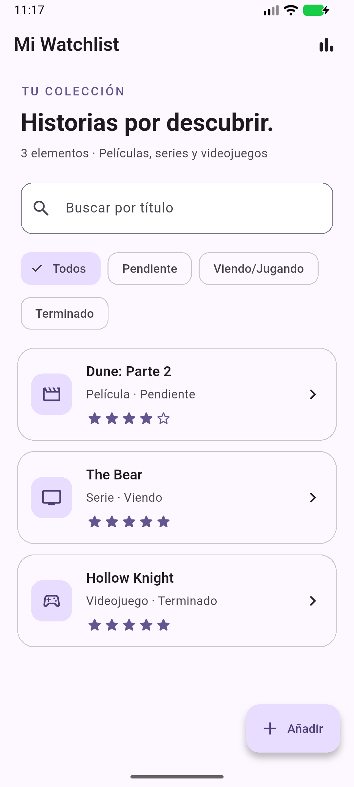
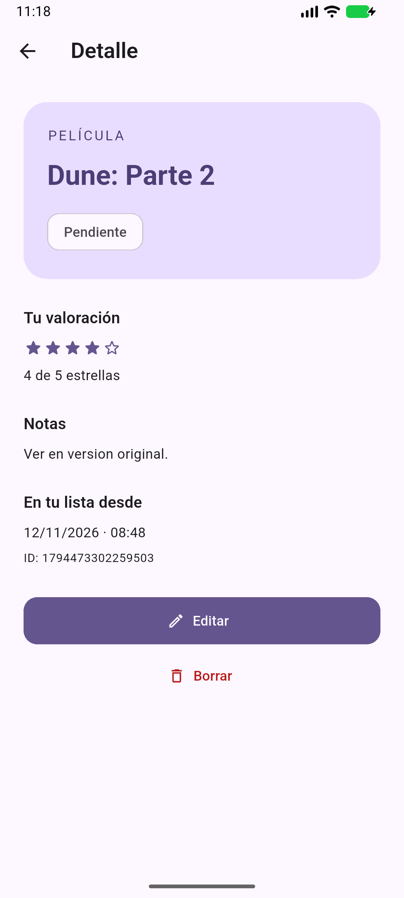

# Mi Watchlist

Tu colección personal de películas, series y videojuegos. Añade lo que quieres
ver o jugar, registra tu progreso, valora con estrellas y consulta estadísticas.
Los datos se guardan en el dispositivo, sin cuentas. Las portadas opcionales se cargan desde el enlace que añadas.

Proyecto educativo de Desarrollo de Interfaces. Implementado con Flutter, Dart,
`StatefulWidget`, `setState` y navegación con `Navigator`.

El [plan por módulos](docs/plan_implementacion.md) organiza el trabajo de M00 a
M08. La [guía de estilos](docs/estilos.md) explica cómo cambiar colores,
tipografía, controles y medidas compartidas.

## Ejecutar

Entorno utilizado: Flutter 3.47.9 y Dart 3.13.7. Ejecuta los comandos desde esta
carpeta (`miwatchlist`), donde se encuentra `pubspec.yaml`.

```bash
flutter pub get
flutter devices
flutter run -d <id-del-dispositivo-android>
```

Para arrancar un emulador ya configurado:

```bash
flutter emulators
flutter emulators --launch <id-del-emulador>
```

Chrome puede servir de apoyo: `flutter run -d chrome`.

## Qué puedes hacer

- Crear, consultar, editar y borrar elementos con confirmación.
- Validar títulos de 1 a 60 caracteres después de eliminar espacios exteriores.
- Distinguir película, serie y videojuego; registrar pendiente, en curso o terminado.
- Valorar de 1 a 5 estrellas o quitar la valoración (0 = sin valorar).
- Buscar por título sin distinguir mayúsculas y combinar la búsqueda con el filtro.
- Consultar recuentos por estado, media de valorados y tipos más frecuentes.
- Cerrar y volver a abrir conservando la colección.

Cancelar el formulario no modifica los datos. La edición conserva identidad,
fecha de alta y posición. Los títulos pueden repetirse. Los ejemplos de las
capturas se crearon durante las pruebas; una instalación nueva empieza vacía.

## Capturas de Android

| Lista | Formulario |
| --- | --- |
|  |  |

| Detalle | Estadísticas |
| --- | --- |
|  |  |

También se incluye la [captura del estado vacío](docs/capturas/vacia.png),
conservada de la validación inicial. Las cuatro pantallas anteriores muestran
el tema actual.

## Organización

```text
lib/
  main.dart
  estilos/
    tema_app.dart
    estilos_app.dart
  modelos/elemento.dart
  servicios/almacen.dart
  pantallas/
    pantalla_lista.dart
    pantalla_formulario.dart
    pantalla_detalle.dart
    pantalla_estadisticas.dart
  widgets/
    tarjeta_elemento.dart
    selector_estrellas.dart
test/
  elemento_test.dart
  formulario_test.dart
  almacen_test.dart
  estadisticas_test.dart
  lista_test.dart
docs/
  bitacora_ia.md
  defensa.md
  validacion.md
  capturas/
```

`PantallaLista` mantiene la colección completa y solicita los guardados a
`Almacen`. El formulario recibe un elemento opcional y devuelve un resultado al
guardar. El detalle solicita cambios mediante callbacks y solo los muestra tras
guardarlos correctamente. Las estadísticas reciben una copia de la colección
completa, independientemente de la búsqueda y el filtro.

`Almacen` utiliza `SharedPreferencesAsync`: un único String JSON con clave
`watchlist`, enums por nombre y fechas ISO 8601. Los datos ausentes o el JSON
dañado producen una lista vacía. Un fallo de acceso ofrece reintento; un fallo de
escritura conserva la colección anterior. No hay sincronización ni exportación.

Dependencia funcional: `shared_preferences` 2.5.6. Herramientas de desarrollo:
`flutter_test` y `flutter_lints`. Los paquetes transitivos del almacenamiento se
resuelven automáticamente y quedan fijados en `pubspec.lock`.

## Pruebas y compilación

```bash
dart format lib test
flutter analyze
flutter test
flutter build apk --debug
```

En el equipo utilizado Windows bloquea `flutter_tester.exe` mediante su política
de control de aplicaciones. Las 19 pruebas se han ejecutado en Chrome, con una
adaptación local para servir CanvasKit por un fallo de rutas del runner en
Windows. Los detalles y las comprobaciones Android están en
[docs/validacion.md](docs/validacion.md).

El APK generado está en `build/app/outputs/flutter-apk/app-debug.apk`. Para la
entrega se copia a `entrega/mi-watchlist-debug.apk`, que se conserva al excluir
`build/`. Se trata de una compilación de depuración.

Para copiar el APK y volver a crear el ZIP después de completar tus documentos:

```bash
python tool/empaquetar.py
```

El ZIP se guarda en `../entrega/mi-watchlist-proyecto.zip` e incluye el APK. Excluye
caches, datos locales del entorno y la carpeta `build`.

Si `flutter pub get` solicita enlaces simbólicos en Windows al preparar las
plataformas de escritorio, puedes omitir esas plataformas solo para el proceso
actual de PowerShell al trabajar con Android:

```powershell
$env:FLUTTER_WINDOWS = 'false'
$env:FLUTTER_LINUX = 'false'
flutter pub get
```

No se ha cambiado la configuración global de Flutter ni la seguridad de Windows.

## Requisitos del enunciado

| Requisitos | Implementación |
| --- | --- |
| R1–R2 | Lista con tarjetas y estado vacío con botón de alta. |
| R3–R4 | FAB y formulario validado. |
| R5–R7 | Detalle, edición reutilizada y borrado confirmado con aviso. |
| R8–R9 | Filtros por estado y búsqueda combinada. |
| R10 | Persistencia JSON local y carga inicial con indicador. |
| R11 | Total, barras por estado, media sin ceros y tipos empatados. |
| R12 | Tarjeta y selector de estrellas en archivos independientes. |
| R13 | Tema propio con ColorScheme.fromSeed. |

## Antes de entregar al profesor

El código y sus comentarios iniciales los ha generado IA. Quedan tareas que el
enunciado exige realizar personalmente:

- Dibujar las cuatro pantallas **sin IA** y guardar `docs/boceto.png`.
- Comprender cada clase y reescribir sus comentarios `///` con tus palabras.
- Completar las reflexiones y preguntas de la [bitácora](docs/bitacora_ia.md) sin IA.
- Ensayar la [defensa individual](docs/defensa.md).

La bitácora documenta la intervención real de IA y deja las respuestas personales
pendientes. Las ampliaciones opcionales no forman parte de esta versión.

## Imágenes para películas, series y videojuegos

El apartado **Imagen de portada** aparece siempre al crear o editar un elemento,
sea película, serie o videojuego.
Pega un enlace directo a una imagen (preferentemente HTTPS) y pulsa **Ver imagen**
para previsualizarla. Puedes quitarla o sustituirla al editar. Guardar conserva el
enlace junto con el elemento; cancelar descarta los cambios.

La misma imagen aparece en la cabecera de la tarjeta, en la miniatura junto al
título (en lugar del mando) y en el detalle. Se guarda el enlace, no una copia
local: necesita Internet y que el servidor permita mostrarla. Si no está disponible
se muestra una cabecera de reserva. Los elementos anteriores siguen funcionando.
La selección desde galería no está incluida: esta versión mantiene los paquetes
permitidos del enunciado.

Las capturas anteriores documentan la revisión previa; los elementos con imagen tienen
una cabecera visual con portada o degradado.
