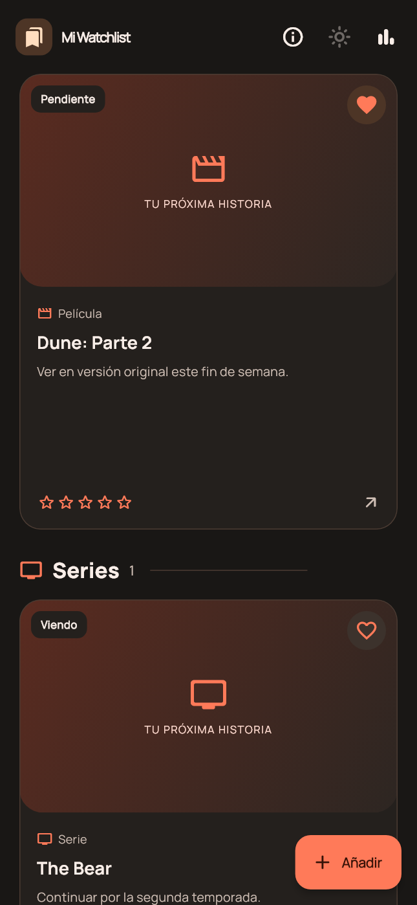
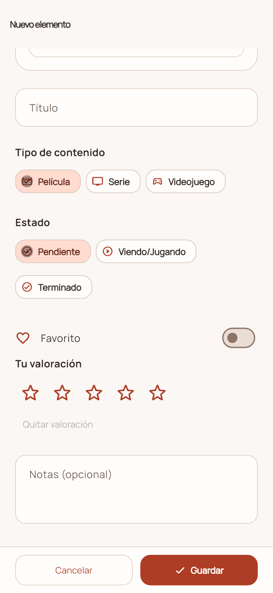
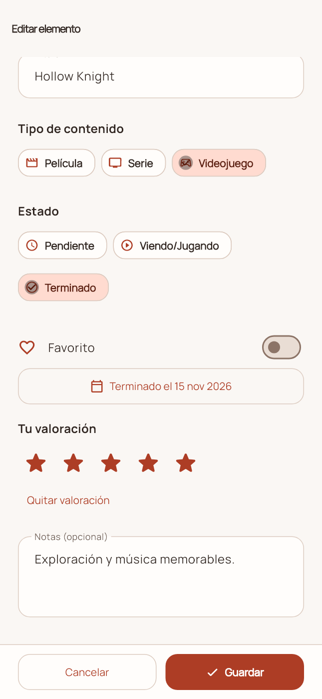
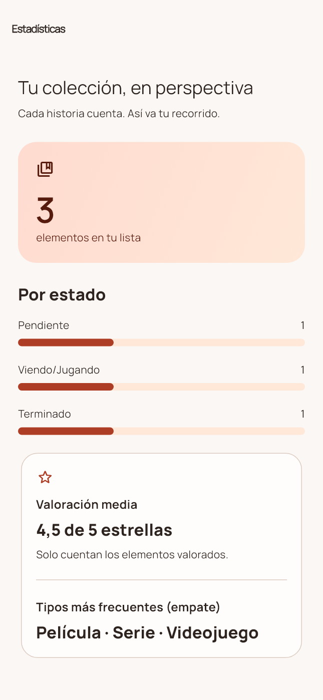
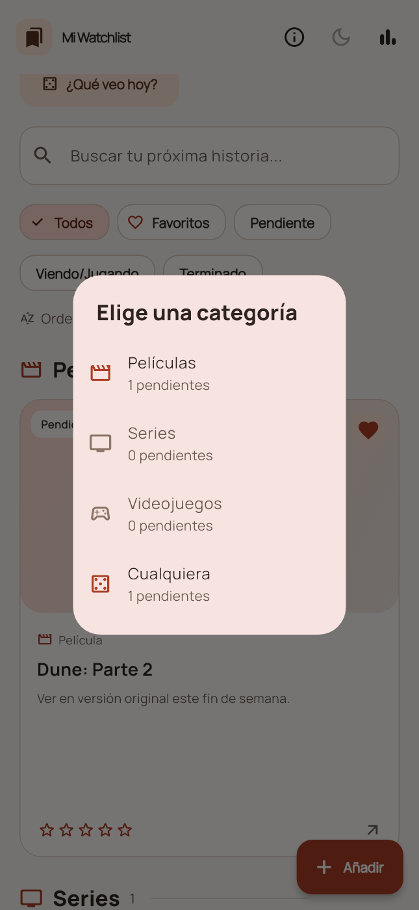
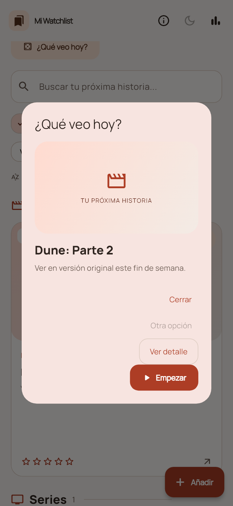
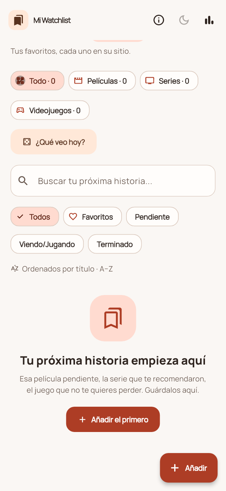
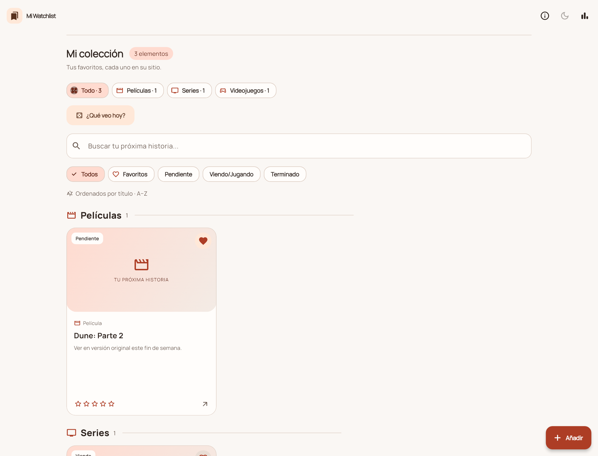

# Mi Watchlist

**Autor:** Mario Rodriguez · **Asignatura:** Desarrollo de Interfaces
**Versión:** 1.0.0+1 · **Documentación:** 17 de noviembre de 2026
**Versión del código documentada:** `20b87b4`.

Mi Watchlist reúne películas, series y videojuegos pendientes, en curso y terminados.
Permite registrar notas, valoraciones y favoritos y consultar estadísticas. La colección
se guarda localmente; no hay cuentas ni sincronización entre Android y el navegador.

- [Abrir la web](https://mariocaseria7-coder.github.io/miwatchlist/).
- [Descargar APK release](https://github.com/mariocaseria7-coder/miwatchlist/releases/latest/download/app-release.apk).
- [Repositorio](https://github.com/mariocaseria7-coder/miwatchlist).

## Documentación de la entrega

| Documento | Contenido |
| --- | --- |
| [Memoria técnica](docs/memoria.md) | Objetivos, arquitectura, modelo, requisitos y decisiones. |
| [Manual de uso](docs/manual_usuario.md) | Instalación y recorrido de las funciones. |
| [Bitácora de IA](docs/bitacora_ia.md) | Fases y registro técnico, con revisión personal identificada. |
| [Prompts](promts%20de%20IA.txt) | Peticiones reales y ejemplos ficticios separados expresamente. |
| [Validación](docs/validacion.md) | Comprobaciones y límites de las evidencias. |
| [Estilos](docs/estilos.md) | Tema coral, Manrope y adaptación de pantallas. |
| [Defensa](docs/defensa.md) | Guion de demostración y ejercicios de preparación. |
| [Lista de entrega](docs/entrega.md) | Archivos, comandos y pendientes personales. |
| [Plan original](docs/plan_implementacion.md) | Organización histórica de la construcción por módulos. |

## Funciones actuales

- Alta, detalle, edición reutilizada y borrado confirmado.
- Título de 1 a 60 caracteres tras quitar espacios exteriores; estrellas de 0 a 5.
- Colección agrupada por categoría y ordenada por título A–Z, sin distinguir mayúsculas.
- Búsqueda, categoría, estado y favoritos combinables.
- Corazón de favorito en tarjetas y un interruptor en el formulario.
- Notas completas en detalle y edición y resumen de dos líneas en tarjetas.
- Fecha automática al pasar a Terminado, modificable hasta hoy y borrada al reabrir.
- Portada por enlace con encuadre manual, zoom y desplazamiento; marco común 16:9.
- «¿Qué veo hoy?» sortea pendientes por categoría, permite otra opción, ver detalle o empezar.
- Estadísticas de toda la colección, aunque haya filtros, con media solo de valorados.
- Tema claro/oscuro recordado, tipografía Manrope incluida y pantalla Acerca de.

## Capturas actuales

Son **renders de los widgets reales mediante Flutter Test**, con ejemplos aislados.
No son fotografías del móvil ni acreditan una instalación física. La app nueva empieza vacía.

| Colección clara | Colección oscura | Formulario |
| --- | --- | --- |
|  |  |  |

| Edición con fecha y favorito | Detalle | Estadísticas |
| --- | --- | --- |
|  |  |  |

| Selector de categoría | Sugerencia pendiente | Estado vacío |
| --- | --- | --- |
|  |  |  |



Capturas adicionales: [Acerca de](docs/capturas/acerca.png) y
[formulario a 320 píxeles lógicos](docs/capturas/movil-pequeno.png).
Se regeneran con `flutter test tool/capturas_documentacion_test.dart`.

## Ejecutar el proyecto

Entorno comprobado: **Flutter 3.47.9 estable y Dart 3.13.7**. Los comandos se ejecutan
desde la carpeta que contiene este README y `pubspec.yaml`, no desde la carpeta exterior.

```bash
flutter pub get
flutter devices
flutter run -d chrome
```

Para Android, activa depuración USB, conecta y autoriza el ordenador en el teléfono,
y ejecuta `flutter run -d <id-del-movil>`. El id se obtiene con `flutter devices`.
En Xiaomi puede ser necesario autorizar la instalación por USB y aceptar el aviso de
instalación. `INSTALL_FAILED_USER_RESTRICTED` indica que el teléfono rechazó instalar.

## Comprobar y compilar

```bash
dart format --output=none --set-exit-if-changed lib test
flutter analyze
flutter test
flutter build apk --debug
```

La suite habitual contiene **66 pruebas** en esta revisión; no incluye el generador
de capturas ni las tres pruebas exclusivas de Chrome. Para las de Chrome:

```bash
python tool/servidor_portadas_prueba.py
```

En otra terminal:

```bash
flutter test --platform chrome test/encuadre_web_test.dart
```

El servidor sirve únicamente una imagen sintética en localhost. Se prueban gestos,
CORS permitido, CORS bloqueado y un 404 sin desactivar la seguridad del navegador.
El fallo histórico del runner Windows y la verificación actual se distinguen en
[validacion.md](docs/validacion.md).

Para compilar web en la ruta pública:

```bash
flutter build web --release --base-href /miwatchlist/ --no-web-resources-cdn
```

GitHub Actions repite formato, análisis, pruebas habituales y Chrome, compila web/APK
y publica con cada push a `master`. Pages usa GitHub Actions como origen; la Release
`latest` reemplaza el APK. Las direcciones están en `lib/config/app_links.dart`.
La APK release usa firma de desarrollo: no es distribución de producción ni se promete
que la firma se conserve entre runners. El ZIP local incluye un **APK debug** diferente.

## Dependencias y alcance académico

| Paquete | Uso |
| --- | --- |
| `shared_preferences` | Colección JSON y preferencia de tema locales. |
| `google_fonts` 8.2.1 | Estilos Manrope; archivos y licencia incluidos en assets/fonts. |
| `url_launcher` | Abrir web y descarga de APK en el navegador. |
| `package_info_plus` | Versión real en Acerca de, también compatible con web. |
| `flutter_test`, `flutter_lints` | Pruebas y análisis durante desarrollo. |

**Diferencia con el enunciado:** solo permite `shared_preferences` y opcionalmente
`intl`. Los tres paquetes funcionales adicionales requieren criterio del profesor.
También se han incorporado más ampliaciones que el máximo de dos propuesto. Se
documenta lo implementado; no se declara una excepción académica que no consta.
El estado sigue usando `StatefulWidget`, `setState` y `Navigator`, sin gestores externos.

## Preparar el ZIP

```bash
flutter build apk --debug
python tool/empaquetar.py
```

El script copia el APK a `entrega/mi-watchlist-debug.apk`, calcula su SHA-256 y crea
`../entrega/mi-watchlist-proyecto.zip` sin `build`, caches ni credenciales locales.
El repositorio o la web pública también permiten revisar el proyecto según el enunciado.

Antes de considerar completa la entrega quedan el boceto propio `docs/boceto.png`,
las reflexiones y respuestas personales de la bitácora, los comentarios propios y
el ensayo de defensa. Estos pendientes se detallan en [entrega.md](docs/entrega.md).
