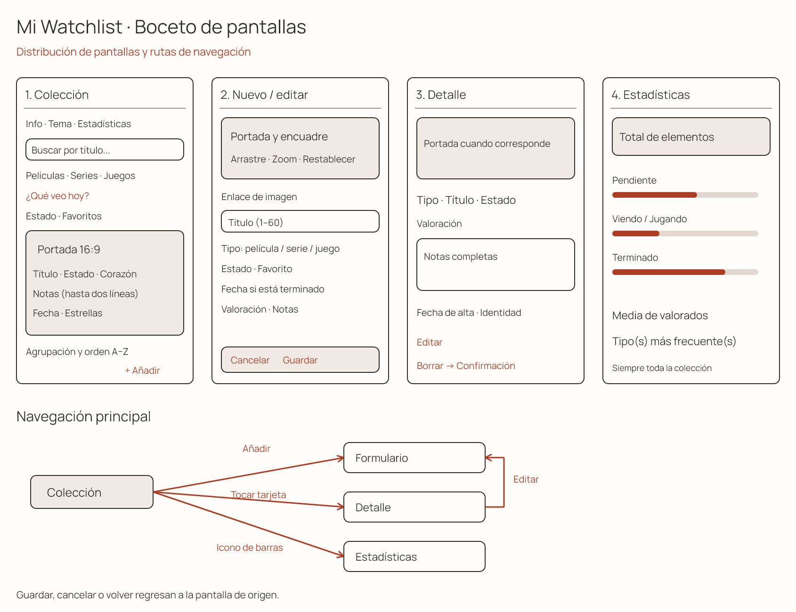

# Boceto documental de Mi Watchlist

**Mario Rodriguez · Desarrollo de Interfaces · 17/11/2026**



## Procedencia y alcance

Esta figura se ha elaborado con IA a petición de Mario después de implementar la
aplicación. Es una reconstrucción esquemática, no una captura de la app ni un dibujo
personal realizado antes de programar. La imagen se presenta sin avisos de procedencia;
esta explicación y la bitácora conservan la información de su elaboración.

El enunciado pide un boceto de fase 0 sin IA. Este archivo sirve de apoyo para
explicar el diseño, pero su existencia no acredita ese requisito. Si se incorpora
un boceto personal, conservar por separado esta reconstrucción y registrar la
procedencia real del nuevo archivo.

## Qué representa

Colección: búsqueda, categorías, estados, favorito, notas, portada y alta.
Formulario: encuadre, título, tipo, estado, favorito, fecha, estrellas y notas.
Detalle: datos básicos, notas completas, edición y confirmación de borrado.
Estadísticas: total, recuentos, media de valorados y tipos más frecuentes.

Las flechas señalan Colección → Formulario al añadir, Colección → Detalle al tocar
una tarjeta, Colección → Estadísticas desde las barras y Detalle → Formulario al
editar. Guardar, cancelar o volver regresan a la pantalla de origen. El dibujo es
un esquema: no reproduce dimensiones ni todas las ampliaciones como Acerca de.

## Fuente reproducible

```bash
flutter test tool/boceto_documentacion_test.dart
```

El código fuente del diagrama está en tool/boceto_documentacion_test.dart y exporta
docs/boceto.png con primitivas de dibujo de Flutter, texto y flechas.
