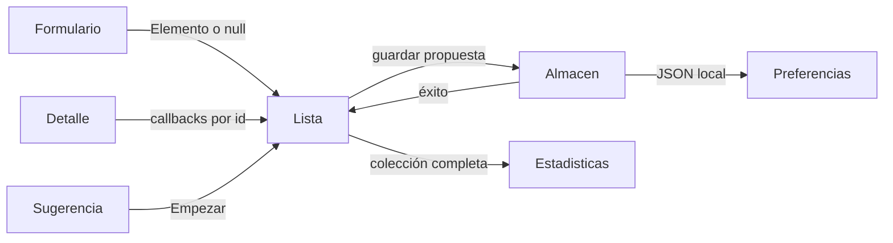

# Memoria técnica · Mi Watchlist

**Mario Rodriguez · Desarrollo de Interfaces**
Versión 1.0.0+1 · 17/11/2026 · Código de referencia `20b87b4`.

## 1. Objetivo y alcance

Organizar películas, series y videojuegos en un solo lugar, distinguiendo lo pendiente,
lo que se está viendo o jugando y lo terminado. Es un proyecto individual educativo
en Flutter/Dart, con interfaz adaptable para Android y navegador y persistencia local.

No se implementan cuentas, sincronización, recomendaciones externas, importación,
exportación de colecciones ni selección desde galería. «¿Qué veo hoy?» es una elección
aleatoria de pendientes propios; no consulta catálogos ni servicios de recomendación.

## 2. Requisitos y trazabilidad

| Requisito | Implementación real | Evidencia principal |
| --- | --- | --- |
| R1 Lista con icono, estado y estrellas | pantalla_lista.dart y tarjeta_elemento.dart; cuadrícula adaptable agrupada | lista_test.dart, mejoras_coleccion_test.dart |
| R2 Estado vacío y alta | Mensaje y Añadir el primero | lista_test.dart, captura vacia.png |
| R3 FAB para alta | Añadir abre el formulario | lista_test.dart |
| R4 Validación | Título tras trim de 1–60; errores claros y valoración 0–5 | formulario_test.dart, elemento_test.dart |
| R5 Detalle | Tipo, título, estado, valoración, notas completas, fecha de alta, id y portada cuando corresponde | lista_test.dart, captura detalle.png |
| R6 Edición reutilizada | Formulario con inicial; conserva identidad y fecha de alta; cancelar devuelve null | lista_test.dart, imagen_juego_test.dart |
| R7 Borrado confirmado | AlertDialog, guardado y aviso tras éxito | lista_test.dart |
| R8 Filtro por estado | ChoiceChip y lista visible calculada | lista_test.dart |
| R9 Búsqueda combinada | trim/toLowerCase/contains junto al resto de filtros | lista_test.dart |
| R10 Persistencia | SharedPreferencesAsync, String JSON watchlist | almacen_test.dart |
| R11 Estadísticas | Total, barras, media sin ceros y todos los tipos empatados | estadisticas_test.dart |
| R12 Componentes | TarjetaElemento y SelectorEstrellas separados, con parámetros/callbacks | Código de widgets y pruebas de formularios/lista |
| R13 Tema | ThemeData y ColorScheme.fromSeed compartidos | diseno_test.dart, formulario_diseno_test.dart |

La tabla señala archivos dentro de `lib/` y `test/`. El detalle muestra los campos
básicos del enunciado. Los campos añadidos favorito y fecha de terminado se consultan
en tarjetas y edición; el detalle no tiene filas propias para esos dos campos.
La fase orientativa pedía ListView.builder y desplegables: la versión final usa
SliverGrid y chips adaptables. No se presenta como una implementación literal de esos ejemplos.

## 3. Organización y flujo de datos

```text
lib/
  main.dart                         arranque, carga y persistencia del tema
  config/app_links.dart             URLs públicas
  modelos/elemento.dart             datos, enums, JSON, copias y fechas
  modelos/encuadre.dart             zoom y posición inmutables
  servicios/almacen.dart            carga y guardado de la colección
  servicios/sugerencia.dart         pendientes y selección aleatoria
  servicios/enlaces_app.dart        apertura de enlaces públicos
  estilos/tema_app.dart              temas claro/oscuro y Manrope
  estilos/estilos_app.dart           medidas, proporción e iconos compartidos
  pantallas/                        lista, formulario, detalle, estadísticas y Acerca de
  widgets/                          tarjetas, estrellas, portada, cabecera y diálogo de sugerencia
```

`PantallaLista` es propietaria de la colección y de búsqueda, categoría, estado y
filtro de favoritos. Calcula `visibles` sin alterar los datos originales. Agrupa por
Tipo y ordena alfabéticamente mediante `toLowerCase().compareTo`; no es ordenación
lingüística específica para acentos. La cuadrícula crea las tarjetas necesarias.

El formulario trabaja sobre controladores y estado local. Guardar valida el Form y
hace `Navigator.pop(context, elemento)`; cancelar devuelve null. La lista espera el
resultado y solicita escritura a Almacen. Solo tras guardar con éxito sustituye su
colección. Detalle solicita actualizar y borrar mediante callbacks `Future<bool>`.
Así, un error de escritura no muestra como confirmado un cambio que no se ha guardado.



## 4. Modelo y serialización

| Campo | Tipo | Valor y comportamiento |
| --- | --- | --- |
| id | String | Identidad; generado desde microsegundos al crear. |
| titulo | String | trim, longitud 1–60. No se exige que los títulos sean únicos. |
| tipo | Tipo | pelicula, serie, videojuego; JSON por name. |
| estado | Estado | pendiente, enCurso, terminado; JSON por name. |
| valoracion | int | 0–5; cero significa sin valorar. |
| notas | String? | Opcional; nota vacía al guardar se convierte en null. |
| fechaAlta | DateTime | Creación; se conserva en edición; ISO 8601 en JSON. |
| imagenUrl | String? | URL opcional http/https validada en formulario. |
| encuadre | Encuadre? | Objeto JSON con zoom 1–5 y x/y entre -1 y 1. |
| favorito | bool | false si falta en datos antiguos. |
| fechaTerminado | DateTime? | ISO 8601; null si falta o el estado no es terminado. |

Los campos son final. `copyWith` crea otra instancia y conserva id y fechaAlta.
Los parámetros opcionales que pueden borrarse distinguen omisión de null mediante
un valor centinela. Si cambia la URL se reinicia el encuadre; quitarla lo elimina.
No se guarda una imagen recortada ni un archivo de portada: solo URL y parámetros.

La transición a terminado mediante copyWith asigna hoy si cambia desde otro estado.
El formulario aplica la misma regla y permite una fecha manual hasta hoy. Volver a
otro estado elimina la fecha. Leer un JSON antiguo terminado no inventa una fecha
histórica; queda ausente. Editar y guardar ese registro desde el formulario puede
asignar hoy si todavía carecía de fecha. Los rótulos usan meses abreviados en español.

## 5. Persistencia y errores

`Almacen.cargar` lee `watchlist`, decodifica la lista y usa Elemento.fromJson. Si no
hay datos, el JSON está dañado o contiene ids duplicados, devuelve una lista vacía.
Un fallo de acceso al almacenamiento se propaga para ofrecer reintento. El JSON
corrupto no se repara ni se exporta automáticamente.

`guardar` serializa toda la colección y espera setString. La lista bloquea operaciones
simultáneas durante la escritura. Un fallo conserva la colección anterior y muestra
un aviso. El tema se guarda por separado en `temaOscuro`, con restauración del valor
anterior si falla su escritura. Los datos no se envían a un servidor propio; los
servidores de portadas sí reciben la petición de imagen cuando se visualizan.

En Android son preferencias del espacio privado de la aplicación; en web pertenecen
al almacenamiento local del navegador y origen. Desinstalar, borrar datos del sitio
o usar otro navegador/dispositivo puede eliminar o separar la colección. No hay copia
de seguridad ni sincronización implementada.

## 6. Ampliaciones implementadas

- Favoritos independientes de la valoración, animación y filtro combinado.
- Fecha de terminado y vista previa de notas en tarjetas.
- Portadas comunes 16:9 con geometría compartida, arrastre, pellizco, rueda,
  deslizador y Restablecer. Cover y límites impiden huecos; el encuadre es relativo.
- Selección aleatoria entre pendientes propios de una categoría o cualquiera.
  Con más de un candidato se excluye el id anterior. Con uno, Otra opción queda
  desactivado. Con cero se ofrece añadir. Empezar pasa a enCurso y espera guardado.
- Orden A–Z por categoría, tema recordado, Acerca de y enlaces de distribución.

Las estadísticas reciben todos los elementos; favoritos, filtros y recomendaciones
no reducen su entrada. La media excluye ceros y evita dividir entre cero; los empates
de tipos más frecuentes se muestran completos.

## 7. Diseño y compatibilidad

Material 3, semilla coral #FF7A59, superficies cálidas y tipografía Manrope incluida.
La variante clara utiliza un primario más oscuro para legibilidad. El ancho de colección
se limita a 1160 y el de detalle/estadísticas a 600 píxeles lógicos. El formulario usa
dos columnas desde 860; el guardado permanece en el pie, ajustándose al teclado.
Los componentes leen el tema actual en ambos modos.

Las portadas requieren Internet y, en la web HTTPS, enlaces seguros con CORS permitido.
Si no cargan, se conserva el mensaje de reserva y se oculta el editor. No se evita
CORS mediante proxy ni desactivando la seguridad. Las fuentes se incluyen localmente.

## 8. Dependencias y diferencias con la propuesta docente

Además de shared_preferences, la aplicación usa google_fonts, url_launcher y
package_info_plus. No están en la lista cerrada de paquetes del enunciado; no consta
aprobación del profesor. La versión también incluye más ampliaciones de las dos
orientativas. La documentación declara estas diferencias para que se puedan valorar.
No se ha eliminado código ni cambiado el alcance funcional al redactar esta memoria.

Los comentarios iniciales y gran parte de la implementación los generó Codex. Los
prompts ficticios están separados de los reales. La documentación no certifica que
el alumno haya comprendido el código, realizado personalmente el boceto o contestado
las preguntas de comprensión: esas evidencias se completan por el alumno.

## 9. Validación, distribución y límites

La revisión funcional documentada pasó 66 pruebas habituales y tres pruebas Chrome
específicas de portadas en GitHub Actions. El historial detallado y la revisión de
la documentación se recogen en validacion.md. El APK debug local y las capturas se
regeneran para esta entrega. No se afirma una prueba reciente en el Xiaomi físico.

El workflow publica web y APK release en cada push a master. La web se sirve bajo
/miwatchlist/ y la Release latest mantiene el enlace de descarga. Esta automatización
no sustituye la comprobación del profesor ni las tareas personales del enunciado.
